# K-Docs · Document management

> Contracts, policies, minutes and case files in one place: every document in its
> folder, with its versions, its signature, its expiry date and a record of who
> touched it. And each client company sees only its own.

**Status:** in production ·
**Proprietary system** by Kusarive Solutions LLC ·
[Versión en español](README.md) ·
[Presentation page](https://rjblancos.github.io/kdocs-showcase/) ·
**[Download the presentation as PDF](presentacion/K-Docs-presentacion.pdf)** (24 slides, in Spanish)

---

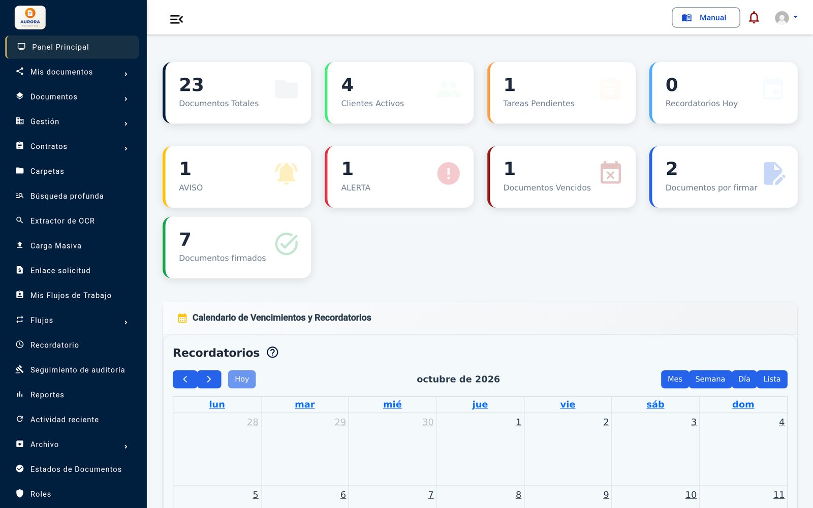

*The main dashboard: document volume, contracts in their notice and alert
periods, documents waiting for a signature and the expiry calendar. Demo
install with made-up data. The interface is in Spanish.*

## The problem

In most companies documents travel by email, chat and USB sticks. Nobody knows
which version is the latest, contracts expire unnoticed, signing means printing
and scanning, and when someone asks who saw or changed a document, there is no
answer.

Whoever keeps documents on behalf of others — a law firm, an accountant, an HR
firm — has one more need: each client should log in and see their papers, and
only theirs.

K-Docs brings all of that into one web platform that works the same on a
computer and on a phone.

## What it does

- **Documents and folders.** Folder tree with unlimited depth, a unique number
  per document, client, status and custom tags.
- **Preview without downloading.** PDF, office documents, spreadsheets,
  presentations, images, text, audio and video open in the browser.
- **Versions.** Every new version keeps the previous one with its comment; any
  version can be downloaded or restored.
- **Search inside the content.** Finds a phrase inside the documents, not just in
  the name, ignoring accents. Scanned files are read with OCR in ten languages,
  in the background.
- **Employment contracts from templates.** Employees, job descriptions and
  templates with fields that fill themselves in. The contract comes out as a
  numbered PDF, in its folder.
- **E-signature by link.** The signer needs no account: they open the link,
  review the document, confirm they read it and sign with a finger or an image,
  on a phone too. The link expires after 72 hours.
- **Expiry by phases.** Term, extensions and renewals, each with a notice date
  and an alert date. The dashboard counts what is in notice, in alert and
  expired, and the calendar shows it.
- **Reminders**, one-off or repeating (daily to yearly), in the app and by email.
- **Approval workflows.** Steps and transitions ("Approve", "Reject"…) with the
  roles or people allowed to take them, optional signature and a log of every
  step.
- **Request links.** Ask someone outside for documents without giving them an
  account: with password, file types, size and expiry. What arrives is approved
  or rejected.
- **Client portal.** Each client company logs in and sees its documents and its
  contacts. Never anyone else's.
- **Controlled sharing.** With people or roles, with a validity period and
  download permission; or by link with password and expiry.
- **Full audit trail.** Every read, download, change, email and permission is
  recorded, and so is every sign-in.
- **Reports** by status, client and dates, with CSV export.
- **Archive** for what must be kept but is no longer in use, with restore.
- **Bulk upload** to bring existing documents in one go.
- **User manual inside the system**, as a PDF, different for each profile.
- **Under your brand:** your own name, logo, icon, sign-in image and email.

## Benefits

| For the company | |
|---|---|
| **One source of truth** | The current document, its history and who did what. |
| **No contract expires by surprise** | Notice and alert before every phase ends, on the dashboard and the calendar. |
| **Signing no longer takes days** | Sent by link and signed on a phone. |
| **Answers an audit in minutes** | The log says who saw, downloaded, changed or shared each document. |

| For its clients | |
|---|---|
| **Their documents, whenever they need them** | No need to ask for them. |
| **Only theirs** | Each company sees only what belongs to it. |
| **From any device** | Designed for small screens too. |

## Screenshots

| Document list | Preview without downloading |
|---|---|
| 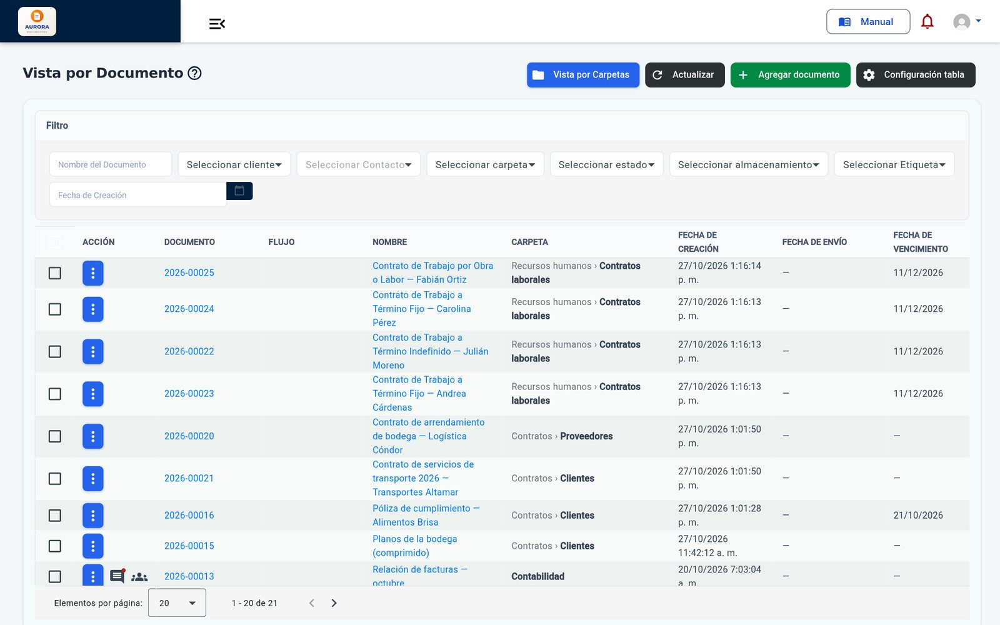 | 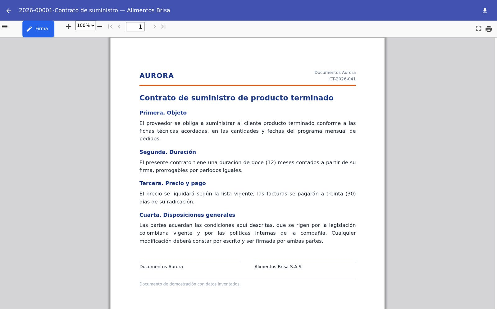 |

| Search inside the content | Contract template editor |
|---|---|
| 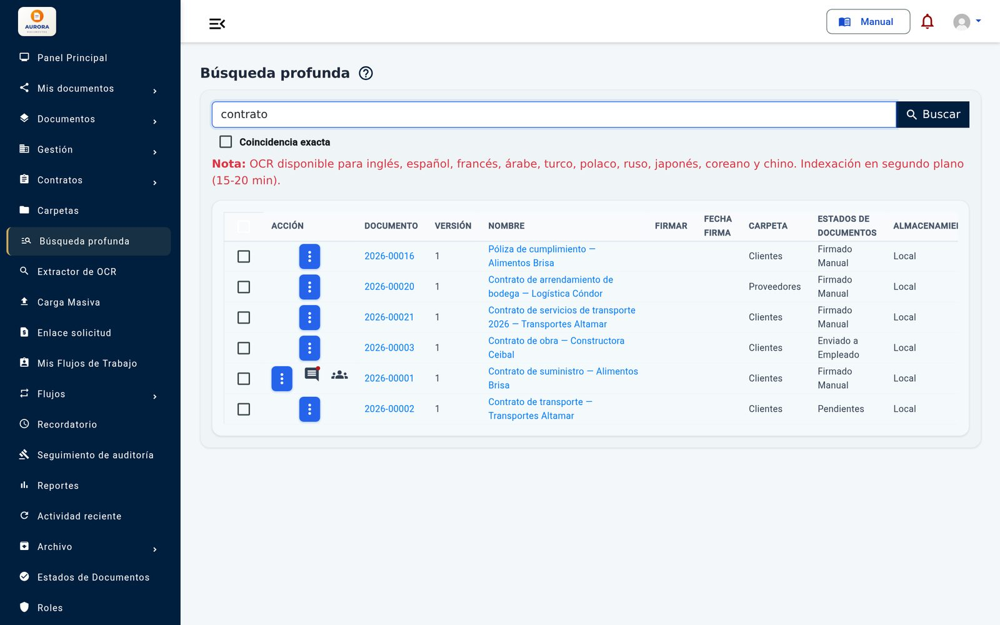 | 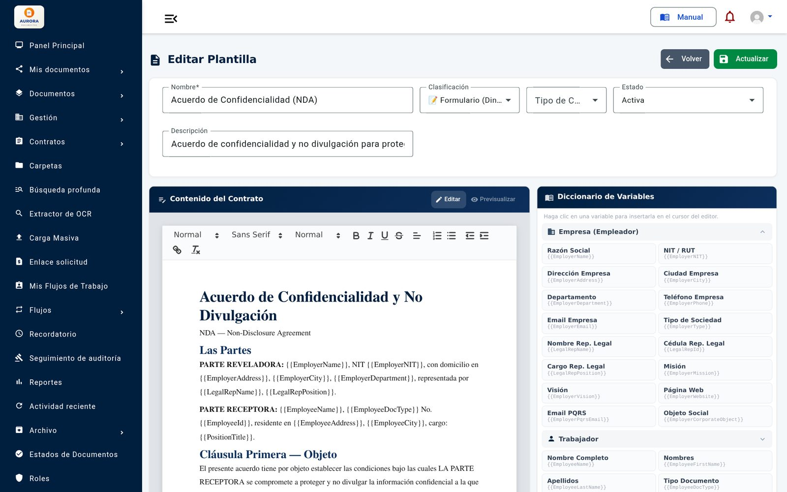 |

| Signing by link | Approval workflow |
|---|---|
| 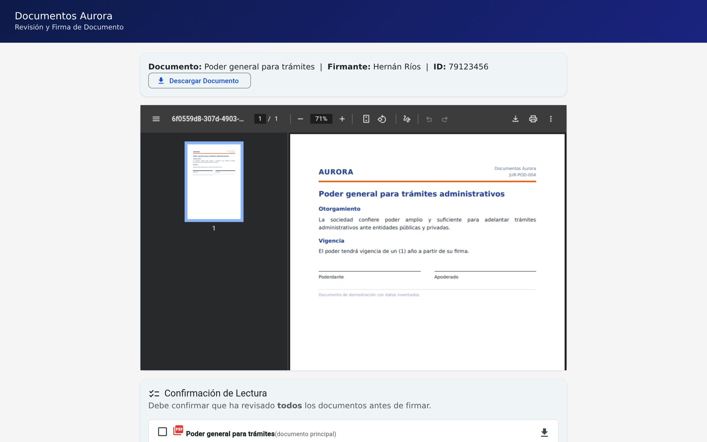 | 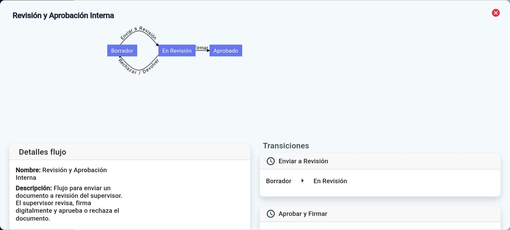 |

| Audit trail | Permissions by role |
|---|---|
| 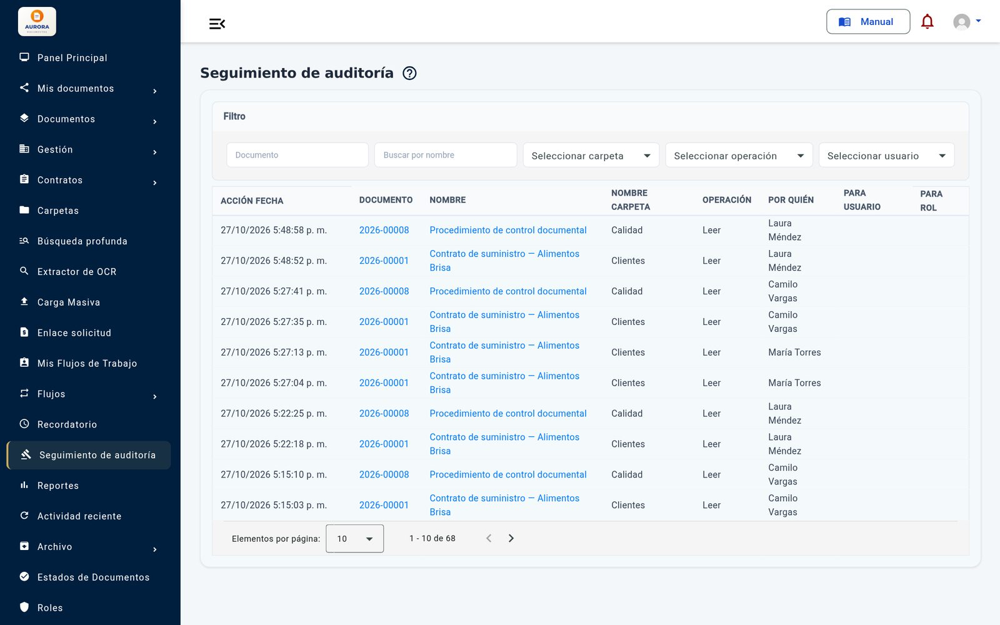 | 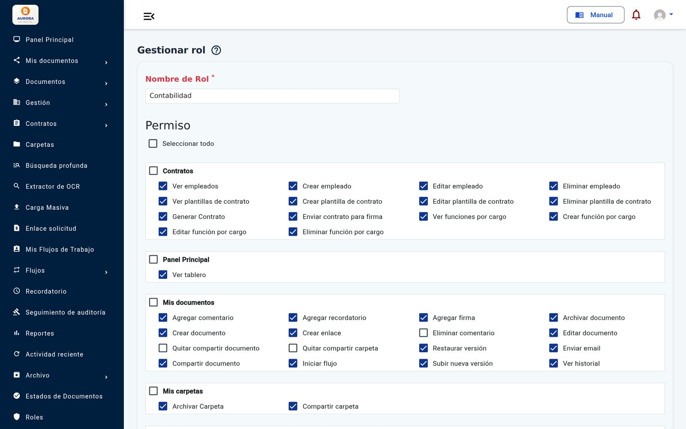 |

| Reports | Contracts in their notice period |
|---|---|
| 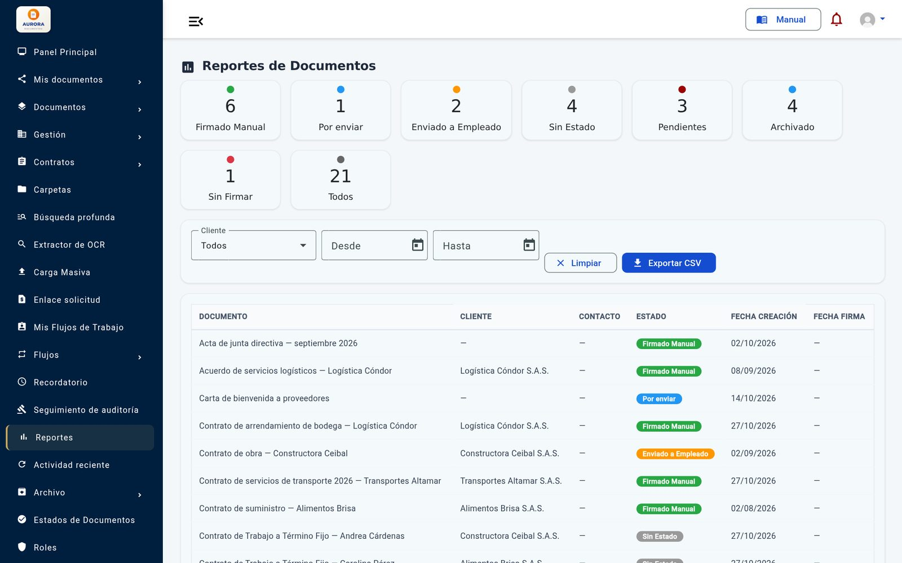 | 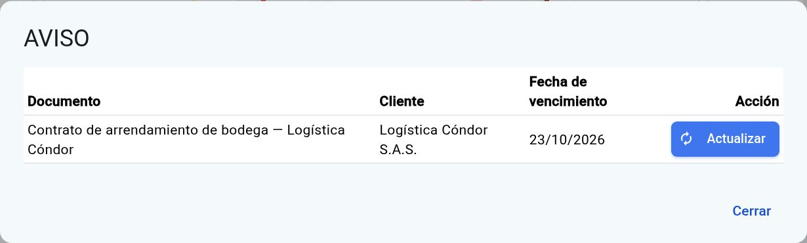 |

| Signing on a phone | Client portal on a phone |
|---|---|
| 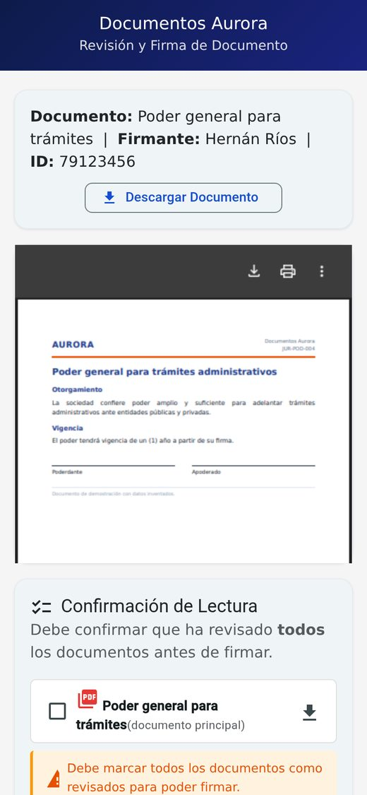 | 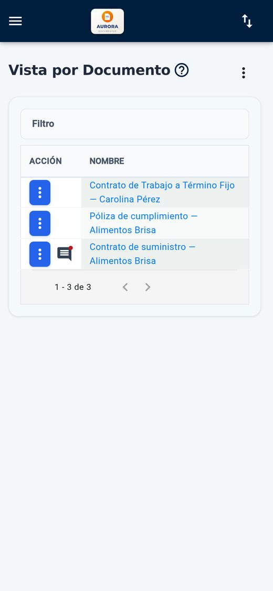 |

Demo install: made-up companies, people and documents.

## Architecture

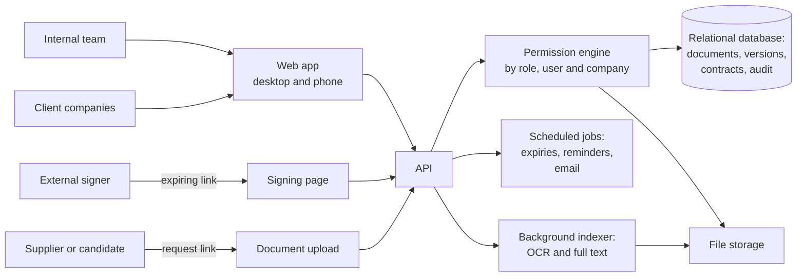

Everything goes through the permission engine: the screen hides what a role
lacks, and the server checks it again on every request.

## Technical guarantees

| Area | What the system guarantees |
|---|---|
| **Isolation** | A client-company user only receives its own documents, contacts and record from the server, also when asking by ID. |
| **Permissions** | Over 120 permissions grouped by screen, by role and by person. Nobody can grant a permission they don't have or make themselves a super admin. |
| **Traceability** | A log of every action on every document, with date and person, and of every sign-in, with its IP address. |
| **Integrity** | Previous versions are never lost; archiving is not deleting. |
| **Credentials** | Passwords stored with key derivation (PBKDF2) and sessions with a signed token. |
| **Signature** | Single-recipient links that expire, with read confirmation and an acceptance statement before signing. |
| **Design** | Tested with every profile on desktop and phone. |

## Built with

| Language | Where | Approximate size |
|---|---|---|
| **C#** | API, permissions, documents, contracts, signatures, workflows and scheduled jobs | 51,800 lines |
| **TypeScript** | The web app | 48,900 lines |
| **HTML** | The screens | 20,700 lines |
| **CSS** | The interface | 5,000 lines |
| **SQL** | Schema and procedures | 2,000 lines |

GitHub's language bar only measures the files in this repository, which is
documentation.

## Results

Real figures from the installs in production, read on 27-Oct-2026. It is used by
a law firm and a meat-processing plant in Colombia; the first install has been
in production for a year.

- **Over 1,450 documents** and **over 2,080 versions**.
- **Over 6,080 actions** recorded in the audit trail.
- **37 client companies** and **90 employees** with their record.
- **531 contract phases** with their notice and alert.
- **48 users**.

## Want your own document management system?

We set it up with your brand, your folders, your roles and your templates,
migrate the documents you already have and train your team with a manual for
each profile.

Rafael Blanco, for Kusarive Solutions LLC

- Web: [kusarive.us](https://kusarive.us)
- Email: info@kusarive.us
- WhatsApp: [+1 407 337 0061](https://wa.me/14073370061)
- Presentation: [24-slide PDF](presentacion/K-Docs-presentacion.pdf) (in Spanish)

© 2026 Kusarive Solutions LLC. See [LICENSE](LICENSE).
