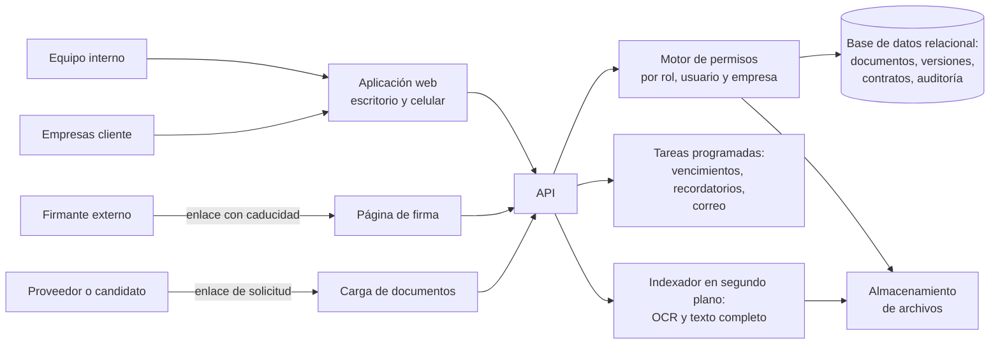

# K-Docs · Gestión documental

> Contratos, pólizas, actas y expedientes en un solo lugar: cada documento en su
> carpeta, con sus versiones, su firma, su vencimiento y el registro de quién lo
> tocó. Y cada empresa cliente ve solo lo suyo.

**Estado:** en producción ·
**Sistema propietario** de Kusarive Solutions LLC ·
[English version](README.en.md) ·
[Página de presentación](https://rjblancos.github.io/kdocs-showcase/) ·
**[Descargar la presentación en PDF](presentacion/K-Docs-presentacion.pdf)** (24 diapositivas)

---

*El panel principal: volumen de documentos, contratos en aviso y en alerta,
documentos por firmar y el calendario de vencimientos. Instalación de
demostración con datos inventados.*

## Qué resuelve

En una empresa los documentos viajan por correo, por mensajería y en memorias
USB. Nadie sabe cuál es la última versión, los contratos vencen sin que nadie
lo note, firmar exige imprimir y escanear, y cuando alguien pregunta quién vio o
cambió un documento, no hay respuesta.

Para quien custodia documentos de terceros —un bufete, una contadora, una firma
de talento humano— se suma otra necesidad: que cada cliente entre y vea sus
papeles, y solo los suyos.

K-Docs reúne todo eso en una plataforma web, en español, que funciona igual en el
computador y en el celular.

## Qué hace

- **Documentos y carpetas.** Árbol de carpetas sin límite de niveles, número
  único por documento, cliente, estado y etiquetas propias.
- **Vista previa sin descargar.** PDF, documentos de oficina, hojas de cálculo,
  presentaciones, imágenes, texto, audio y video se ven en el navegador.
- **Versiones.** Cada versión nueva conserva la anterior, con su comentario; se
  puede descargar o restaurar cualquiera.
- **Búsqueda dentro del contenido.** Encuentra una frase dentro de los
  documentos, no solo en el nombre, sin distinguir tildes. Los escaneados se
  leen con OCR en diez idiomas, en segundo plano.
- **Contratos laborales desde plantillas.** Empleados, funciones por cargo y
  plantillas con campos que se rellenan solos. El contrato sale en PDF, numerado
  y en su carpeta.
- **Firma electrónica por enlace.** Quien firma no necesita cuenta: abre el
  enlace, revisa el documento, confirma la lectura y firma con el dedo o con una
  imagen, también desde el celular. El enlace caduca a las 72 horas.
- **Vencimientos por fases.** Término, prórrogas y renovaciones, cada fase con
  fecha de aviso y de alerta. El panel cuenta lo que está en aviso, en alerta y
  vencido, y el calendario lo pone a la vista.
- **Recordatorios** únicos o repetidos (diarios a anuales), con aviso en la
  plataforma y por correo.
- **Flujos de aprobación.** Pasos y transiciones («Aprobar», «Rechazar»…) con los
  roles o personas que pueden darlas, firma opcional y registro de cada paso.
- **Enlaces de solicitud.** Pide documentos a alguien de fuera sin darle cuenta:
  con contraseña, tipos de archivo, tamaño y fecha de caducidad. Lo recibido se
  aprueba o se rechaza.
- **Portal de clientes.** Cada empresa cliente entra con su usuario y ve sus
  documentos y sus contactos. Nunca los de otra.
- **Compartir con control.** Con personas o roles, con periodo de validez y
  permiso de descarga; o por enlace con contraseña y caducidad.
- **Auditoría completa.** Cada lectura, descarga, cambio, envío y permiso queda
  registrado, igual que cada inicio de sesión.
- **Reportes** por estado, cliente y fechas, con exportación a CSV.
- **Archivo** para lo que se conserva pero ya no se usa, con restauración.
- **Carga masiva** para traer en un paso los documentos que ya existen.
- **Manual de uso dentro del sistema**, en PDF, distinto para cada perfil.
- **Con tu marca:** nombre, logo, icono, imagen de entrada y correo propios.

## Beneficios

| Para la empresa | |
|---|---|
| **Una sola fuente de verdad** | El documento vigente, su historia y quién hizo qué. |
| **Ningún contrato vence por sorpresa** | Aviso y alerta antes de cada fin de fase, en el panel y en el calendario. |
| **Firmar deja de costar días** | Se envía por enlace y se firma desde el celular. |
| **Responde a una auditoría en minutos** | El registro dice quién vio, descargó, cambió o compartió cada documento. |

| Para sus clientes | |
|---|---|
| **Sus documentos, cuando los necesita** | Sin escribir para pedirlos. |
| **Solo los suyos** | Cada empresa ve únicamente lo que le pertenece. |
| **Desde cualquier dispositivo** | Pensado también para pantallas pequeñas. |

## Capturas

| Lista de documentos | Vista previa sin descargar |
|---|---|
|  |  |

| Búsqueda dentro del contenido | Editor de plantillas de contrato |
|---|---|
|  |  |

| Firma por enlace | Flujo de aprobación |
|---|---|
|  |  |

| Seguimiento de auditoría | Permisos por rol |
|---|---|
|  |  |

| Reportes | Contratos en periodo de aviso |
|---|---|
|  |  |

| Firma desde el celular | Portal del cliente en el celular |
|---|---|
|  |  |

Instalación de demostración: empresas, personas y documentos inventados.

## Arquitectura

Todo pasa por el motor de permisos: la pantalla oculta lo que un rol no tiene y
el servidor lo vuelve a comprobar en cada petición.

## Garantías técnicas

| Área | Qué garantiza el sistema |
|---|---|
| **Aislamiento** | Un usuario de empresa cliente solo recibe del servidor sus documentos, sus contactos y su ficha, también al pedirlos por identificador. |
| **Permisos** | Más de 120 permisos agrupados por pantalla, por rol y por persona. Nadie puede dar un permiso que no tiene ni hacerse superadministrador. |
| **Trazabilidad** | Registro de cada acción sobre cada documento, con fecha y persona, y de cada inicio de sesión, con su dirección IP. |
| **Integridad** | Las versiones anteriores no se pierden; archivar no es borrar. |
| **Credenciales** | Contraseñas guardadas con derivación de clave (PBKDF2) y sesiones con token firmado. |
| **Firma** | Enlaces de un solo destinatario que caducan, con confirmación de lectura y declaración de aceptación antes de firmar. |
| **Diseño** | Probado con cada perfil en escritorio y en celular. |

## Construido con

| Lenguaje | Dónde | Tamaño aproximado |
|---|---|---|
| **C#** | API, permisos, documentos, contratos, firma, flujos y tareas programadas | 51.800 líneas |
| **TypeScript** | La aplicación web | 48.900 líneas |
| **HTML** | Las pantallas | 20.700 líneas |
| **CSS** | La interfaz | 5.000 líneas |
| **SQL** | Esquema y procedimientos | 2.000 líneas |

La barra de lenguajes de GitHub mide solo los ficheros de este repositorio, que
es documentación.

## Resultados

Cifras reales de las instalaciones en producción, leídas el 27-oct-2026. Lo usan
un bufete de abogados y una planta de beneficio en Colombia; la primera
instalación lleva un año en producción.

- **Más de 1.450 documentos** y **más de 2.080 versiones**.
- **Más de 6.080 acciones** registradas en la auditoría.
- **37 empresas cliente** y **90 empleados** con su ficha.
- **531 fases de contrato** con su aviso y su alerta.
- **48 usuarios**.

## ¿Quieres tu gestor documental?

Lo instalamos con tu marca, tus carpetas, tus roles y tus plantillas, migramos
los documentos que ya tienes y capacitamos a tu equipo con un manual para cada
perfil.

Rafael Blanco, para Kusarive Solutions LLC

- Web: [kusarive.us](https://kusarive.us)
- Correo: info@kusarive.us
- WhatsApp: [+1 407 337 0061](https://wa.me/14073370061)
- Presentación: [PDF de 24 diapositivas](presentacion/K-Docs-presentacion.pdf)

© 2026 Kusarive Solutions LLC. Ver [LICENSE](LICENSE).
